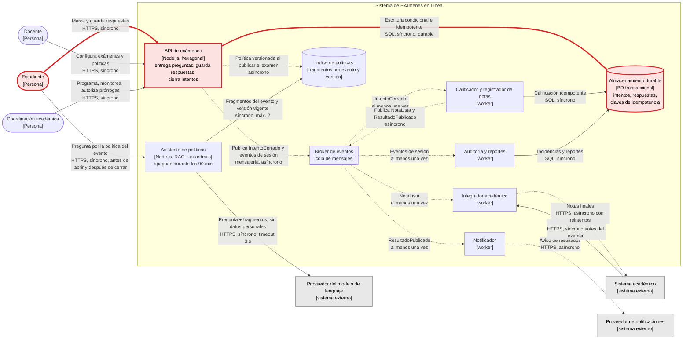

# Vista de contenedores C4: Sistema de Exámenes en Línea

Versión del segundo previo. Cambios frente a la versión anterior ([contenedores.dsl](contenedores.dsl), imagen anterior en [img/contenedores-v1.png](img/contenedores-v1.png)):

- Se agrega el **Asistente de políticas** y su **Índice de políticas** ([ADR-002](adr/ADR-002-asistente-de-politicas-rag.md)).
- Se agrega el **Proveedor del modelo de lenguaje** como **sistema externo**, igual que el sistema académico o el proveedor de notificaciones.
- Se marca en **rojo y grueso** el **camino del escenario** probado en el [ADR-003](adr/ADR-003-idempotencia-y-secuencia-en-autoguardado.md): Estudiante → API de exámenes → Almacenamiento durable.

Línea continua: el que llama espera la respuesta. Línea punteada: nadie espera; el mensaje queda en el broker.

## Relaciones nuevas o con decisión explícita

| Origen → destino | Protocolo | Síncrono / asíncrono | Tiempo máximo de espera | Si falla |
| --- | --- | --- | --- | --- |
| Asistente → Proveedor del modelo | HTTPS (API del proveedor) | Síncrono | **3 s** (timeout) | Plan B sin modelo: texto literal de la política + camino a coordinación |
| Asistente → Índice de políticas | Consulta interna | Síncrono | 500 ms | Plan B: página estática de la política |
| Estudiante → Asistente | HTTPS | Síncrono; solo antes de la apertura y después del cierre | 3,5 s (timeout del modelo + recuperación) | El examen no se afecta: el asistente no está en la ruta crítica |
| **Estudiante → API de exámenes** (escenario) | HTTPS | Síncrono | Confirmación solo tras escritura durable | El navegador conserva la operación y la reintenta con el mismo `operationId` |
| **API → Almacenamiento durable** (escenario) | SQL / driver | Síncrono, durable | Lo que tarde la escritura confirmada | Sin confirmación al estudiante; la respuesta queda "pendiente" |

## Camino del escenario (Parte B)

El escenario "ninguna respuesta se pierde aunque la red repita y desordene los autoguardados" solo toca tres elementos de esta vista:

1. **Estudiante (navegador)**: envía cada autoguardado con `operationId`, `attemptId`, `questionId` y `sequence`, y lo reintenta si no recibe confirmación.
2. **API de exámenes**: adaptador de entrada → caso de uso `guardarRespuesta` → puerto `AlmacenRespuestas`.
3. **Almacenamiento durable**: en la prueba es un adaptador simulado en memoria con latencia.

No intervienen autenticación, banco de preguntas, broker ni workers, así que no se implementan. El código está en [`src/`](../src) y la prueba en [`test/escenario.test.js`](../test/escenario.test.js).
