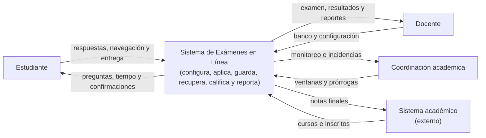

# Visión del sistema: Exámenes conjuntos en línea

## 1. Propósito y contexto de negocio

La universidad necesita aplicar exámenes finales conjuntos en línea para entre 3.000 y 5.000 estudiantes simultáneamente. Cada evaluación tiene una ventana estricta de 90 minutos, con una hora de inicio común y sin una segunda oportunidad logística sencilla. Una interrupción de diez minutos puede afectar la totalidad del examen y obligar a coordinar nuevamente a numerosos docentes y estudiantes.

El sistema actual, basado en un módulo genérico del campus virtual, presenta degradación de rendimiento durante el pico y ya ocasionó pérdida de respuestas. El nuevo Sistema de Exámenes en Línea debe priorizar la continuidad de la evaluación y la conservación de las respuestas, sin dejar de ofrecer mecanismos proporcionales para fortalecer la integridad académica.

La solución debe dificultar la copia mediante la aleatorización de preguntas y opciones, controlar la ventana de tiempo y registrar eventos relevantes. No debe exigir la instalación de software de vigilancia en los equipos personales ni convertir automáticamente una señal técnica en una sanción. Los eventos deben servir como evidencia contextual para una revisión humana y un eventual debido proceso.

## 2. Objetivos

### Objetivos principales

- Permitir que hasta 5.000 estudiantes inicien el mismo examen de forma simultánea.
- Entregar la primera pregunta a cada estudiante en un máximo de 5 segundos desde el inicio.
- Confirmar y conservar todas las respuestas que el sistema haya aceptado.
- Permitir reanudar un intento después de una desconexión dentro del tiempo restante.
- Aplicar una versión individual y reproducible del examen mediante aleatorización.
- Registrar eventos relevantes sin vigilancia invasiva.
- Calificar, revisar, reportar y transferir los resultados después de la aplicación.

### Objetivos operativos

- Escalar la capacidad durante el evento sin mantener esa capacidad durante todo el semestre.
- Aislar los fallos de telemetría, reportes o integración para que no interrumpan la evaluación.
- Permitir que coordinación monitoree el estado general de la aplicación en tiempo real.
- Recuperar el servicio y los datos mediante redundancia, backups y procedimientos probados.

## 3. Alcance

### Incluye

- Gestión y versionado del banco de preguntas.
- Configuración de exámenes, categorías, dificultad y reglas de selección.
- Sincronización de estudiantes inscritos.
- Generación de un intento individual con orden de preguntas y opciones aleatorizado.
- Control de apertura, cierre, duración y prórrogas autorizadas.
- Autoguardado y recuperación de respuestas.
- Registro de sesiones, desconexiones y otros eventos definidos por la universidad.
- Calificación automática de preguntas cerradas.
- Revisión, reclamos, reportes y publicación diferida.
- Transferencia de notas finales al sistema académico.

### No incluye

- Vigilancia por video, audio o captura de pantalla.
- Lectura de teclas o del contenido de otras aplicaciones.
- Decisiones automáticas de culpabilidad o sanción.
- Reemplazo del sistema académico institucional.
- Resolución automática de todos los casos pedagógicos que requieran criterio docente.

## 4. Actores e intercambios

| Actor | Tipo | Información que entrega | Información que recibe |
| --- | --- | --- | --- |
| Estudiante | Persona | Credenciales institucionales, respuestas, navegación, entregas y eventos técnicos de su sesión | Preguntas y opciones asignadas, estado del intento, tiempo restante, confirmación de guardado, avisos de conexión y resultado cuando se publique |
| Docente | Persona | Banco de preguntas, versiones, categorías, dificultad, configuración, criterios de evaluación y resolución de reclamos | Examen armado, estado de la aplicación, respuestas, calificaciones, reportes e indicadores para revisión |
| Coordinación académica | Persona/rol institucional | Programación de ventanas, autorizaciones de prórroga, reglas operativas y acciones de contingencia | Estado general de la aplicación, estudiantes afectados, incidencias, métricas y reportes de cierre |
| Sistema académico | Sistema externo | Cursos, comisiones, período y lista de estudiantes inscritos | Notas finales y estado de la evaluación una vez cerrado el proceso de reclamos |

### Responsabilidades de los actores

El **estudiante** presenta el examen desde un navegador, en campus o desde su casa. Debe poder continuar ante una desconexión breve sin reiniciar el intento y debe recibir una indicación clara cuando una respuesta todavía no fue confirmada por el servidor.

El **docente** prepara preguntas y criterios, publica versiones inmutables para una aplicación, revisa resultados y analiza reclamos. No modifica el contenido de un examen que ya está en curso.

La **coordinación académica** programa la aplicación, valida que la infraestructura esté preparada, monitorea el evento y autoriza extensiones individuales según las reglas institucionales.

El **sistema académico** es la fuente de matrícula y el destino de las notas finales. Una indisponibilidad temporal de este sistema no debe detener un examen cuya lista de inscritos ya fue sincronizada.

## 5. Funciones esenciales

Las funciones esenciales son aquellas sin las cuales el sistema no cumpliría su propósito principal de realizar una evaluación conjunta confiable.

### 5.1 Gestionar el banco de preguntas

El docente crea, edita, clasifica y versiona preguntas por curso, categoría, dificultad y tipo. Las versiones publicadas son inmutables para garantizar que todos los intentos puedan reconstruirse con el contenido que estaba vigente al comenzar la evaluación.

### 5.2 Armar el examen

El docente define la cantidad de preguntas, las categorías, los criterios de selección, la duración, la ventana de aplicación, la política de navegación, las prórrogas y el mecanismo de calificación. Al publicar, el sistema congela la configuración y las versiones de preguntas utilizadas.

### 5.3 Generar exámenes individualizados

Para cada estudiante se seleccionan preguntas y se ordenan preguntas y opciones mediante una semilla individual. La asignación es determinista y queda asociada al intento: repetir una solicitud o reconectarse no genera un examen diferente. La preparación puede realizarse antes de la apertura o bajo demanda y luego almacenarse.

### 5.4 Administrar la aplicación

El sistema abre y cierra el examen en la ventana establecida, controla el tiempo usando el reloj del servidor y aplica prórrogas autorizadas. Un estudiante no obtiene tiempo adicional por desconectarse, salvo que exista una extensión explícita registrada por coordinación.

### 5.5 Guardar y recuperar respuestas

Cada respuesta se envía con un identificador único de operación y se confirma únicamente después de una escritura durable. El cliente puede mantener temporalmente operaciones pendientes en el navegador y reintentarlas. El servidor procesa reintentos de forma idempotente para no duplicar ni sobrescribir una respuesta más reciente.

### 5.6 Registrar eventos de sesión

Se registran eventos relevantes como inicio, entrega, desconexión, reconexión, cambio de pestaña cuando el navegador lo informa, múltiples sesiones y patrones de tiempo anómalos. Estos eventos son indicadores y evidencia para revisión, no sanciones automáticas.

### 5.7 Calificar y publicar resultados

Las preguntas cerradas se califican automáticamente contra la versión congelada del examen. Las preguntas abiertas pueden quedar pendientes de revisión. Los resultados se mantienen ocultos hasta terminar la política institucional de reclamos y luego pueden publicarse y enviarse al sistema académico.

### 5.8 Generar reportes

El sistema proporciona presentados, ausentes, respuestas confirmadas, incidencias, eventos, tiempos, calificaciones y distribución de notas. Los reportes operativos no deben sobrecargar el almacenamiento utilizado por los intentos activos.

## 6. Diagrama de contexto C4

### 6.1 Qué debe mostrar

El diagrama C4 de **contexto** debe mostrar un único sistema central, sus actores y los sistemas externos con los que intercambia información. En este nivel no se deben dibujar servicios internos como el servicio de respuestas, auditoría o calificación; esos elementos corresponden a un diagrama C4 de contenedores, que puede elaborarse a partir del ADR.

El sistema central es:

> **Sistema de Exámenes en Línea:** plataforma que permite configurar, aplicar, guardar, recuperar, calificar y reportar exámenes conjuntos de alta concurrencia.

Las relaciones del contexto son:

- **Estudiante -> Sistema:** inicia sesión, presenta el examen, responde preguntas, entrega el intento y genera eventos de sesión.
- **Sistema -> Estudiante:** entrega preguntas y opciones aleatorizadas, informa tiempo y estado, confirma respuestas y comunica el resultado cuando corresponde.
- **Docente -> Sistema:** administra preguntas, configura exámenes, revisa resultados y atiende reclamos.
- **Sistema -> Docente:** entrega exámenes armados, respuestas, calificaciones, reportes e indicadores de incidencias.
- **Coordinación académica -> Sistema:** programa aplicaciones, monitorea eventos y autoriza prórrogas.
- **Sistema -> Coordinación académica:** informa estado, capacidad, incidencias, estudiantes afectados y resultados operativos.
- **Sistema académico -> Sistema:** entrega cursos e inscripciones congeladas para la aplicación.
- **Sistema -> Sistema académico:** envía notas finales después del cierre del proceso de reclamos.

### 6.2 Representación textual del contexto

El contexto C4 se mantiene como la vista conceptual del sistema. La vista detallada de contenedores se encuentra en [contenedores.dsl](contenedores.dsl) y muestra las piezas que corren por separado: API, almacenamiento durable, broker, workers de calificación, auditoría, notificaciones e integración académica. Por tanto, ese archivo ya no representa el nivel de contexto, sino el nivel de contenedores C4.

## 7. Escenarios de calidad

Los escenarios se expresan con fuente, estímulo, artefacto, entorno, respuesta y medida.

### 7.1 Escenario de rendimiento y capacidad

| Parte | Descripción |
| --- | --- |
| Atributo | Rendimiento y capacidad bajo carga |
| Fuente | Hasta 5.000 estudiantes que presentan simultáneamente el examen final |
| Estímulo | Los estudiantes ingresan a las 8:00:00 e inician el examen al mismo tiempo |
| Artefacto | Sistema de Exámenes en Línea, capa de entrada, servicio de intentos y servicio de entrega de preguntas |
| Entorno | Inicio simultáneo de un examen conjunto, con 5.000 usuarios concurrentes y capacidad previamente preparada |
| Respuesta | El sistema acepta las solicitudes, crea o recupera los intentos, entrega la primera pregunta y continúa aceptando la interacción sin perder solicitudes |
| Medida | Al menos el 99 % de los estudiantes debe haber cargado su primera pregunta como máximo a las 8:00:05. La prueba debe incluir autenticación, asignación, lectura y tráfico representativo de autoguardado |

Este escenario obliga a precalentar instancias, distribuir tráfico, evitar una dependencia síncrona del sistema académico y preparar las asignaciones antes del segundo cero o generarlas de forma determinista y cacheada.

### 7.2 Escenario de disponibilidad, recuperabilidad y persistencia

| Parte | Descripción |
| --- | --- |
| Atributo | Disponibilidad, recuperabilidad y persistencia de datos |
| Fuente | Estudiante que está presentando el examen |
| Estímulo | El estudiante marca una respuesta y posteriormente pierde la conexión o su equipo falla |
| Artefacto | Sistema de respuestas, almacenamiento durable e intento activo del estudiante |
| Entorno | Examen en ejecución dentro de la ventana de 90 minutos, con conexión doméstica inestable |
| Respuesta | El sistema conserva toda respuesta confirmada, permite recuperar el estado exacto del intento y acepta operaciones pendientes al reconectar |
| Medida | El 100 % de las respuestas confirmadas antes de la desconexión debe conservarse y estar disponible al reanudar dentro del tiempo restante. Reintentar una operación no debe duplicar su efecto |

> **Segundo previo:** este es el escenario prioritario que se probó. La medida se corrigió para que tenga estímulo y ventana: 0 respuestas confirmadas perdidas y 0 registros duplicados sobre todos los autoguardados de una aplicación (5.000 × 10), con el 20 % de los autoguardados repetidos y a destiempo. Ver [ADR-003](adr/ADR-003-idempotencia-en-autoguardado.md).

La confirmación visible para el estudiante representa una garantía del servidor, no solamente el almacenamiento local del navegador. La cola local es una ayuda para la reconexión, pero la fuente de verdad es el almacenamiento durable del sistema.

### 7.3 Escenario de integridad sin vigilancia invasiva

| Parte | Descripción |
| --- | --- |
| Atributo | Integridad, privacidad y trazabilidad |
| Fuente | Estudiante durante un examen activo |
| Estímulo | Se produce un cambio de pestaña, una desconexión, una sesión concurrente o un patrón de tiempo inusual |
| Artefacto | Servicio de eventos y auditoría |
| Entorno | Examen en ejecución, con alta concurrencia y sin software instalado en el equipo personal |
| Respuesta | El sistema registra el evento con contexto, lo envía a procesamiento sin bloquear el examen y lo deja disponible para revisión autorizada |
| Medida | El evento debe registrarse sin agregar latencia perceptible a la entrega o al autoguardado; ningún evento debe generar automáticamente una sanción |

La señal puede tener explicaciones legítimas, como una falla de conectividad o una limitación del navegador. Por eso el diseño conserva evidencia y contexto, pero deja la decisión académica a las personas responsables.

## 8. Operaciones síncronas y asíncronas

La clasificación se realiza según si el estudiante necesita el resultado para continuar y según el impacto de una demora sobre la integridad del intento.

### 8.1 Operaciones síncronas de la ruta crítica

#### Carga y recuperación de una pregunta

Es síncrona porque el estudiante necesita recibir la pregunta y las opciones para continuar. La solicitud debe ser atendida por una instancia saludable y devolver también el tiempo restante calculado por el servidor.

#### Guardado y confirmación de una respuesta

Aunque el procesamiento interno puede utilizar replicación o mecanismos de persistencia, desde el punto de vista del estudiante es una operación síncrona: el sistema debe confirmar que la respuesta fue aceptada. No se debe mostrar una respuesta como guardada solo porque quedó en memoria del navegador o en una cola sin garantía de durabilidad.

#### Recuperación del estado del intento

Es síncrona al reconectar. El sistema devuelve preguntas asignadas, respuestas confirmadas, operaciones pendientes reconocidas, estado del intento y tiempo restante.

#### Autenticación y autorización

Son síncronas porque deben resolverse antes de permitir el acceso a un intento o a una operación administrativa.

### 8.2 Operaciones asíncronas

#### Registro y procesamiento de eventos

Los eventos de sesión se envían a una cola o bus para no agregar latencia al examen. Si el consumidor falla, permanecen temporalmente pendientes y se procesan después. La caída del procesamiento analítico no debe impedir el guardado de respuestas.

#### Calificación y generación de reportes

Después del cierre, la calificación, las agregaciones y los reportes pueden procesarse en segundo plano. Deben ser idempotentes y mostrar un estado como pendiente, procesando o completo.

#### Integración con el sistema académico

La transferencia de notas ocurre después de reclamos y publicación. Puede reintentarse si el sistema externo está caído, usando mensajes idempotentes y una bandeja de errores sin afectar los exámenes activos.

#### Backups y mantenimiento

Se ejecutan fuera de la interacción del estudiante, con monitoreo y pruebas de restauración. Durante la ventana crítica se priorizan operaciones de lectura, guardado y recuperación.

### 8.3 Qué sucede si falla el otro extremo

Si falla un servicio síncrono, el estudiante debe recibir un estado claro y no una falsa confirmación. El navegador conserva temporalmente las operaciones no confirmadas y reintenta con backoff; la interfaz muestra que la respuesta está pendiente. La reconexión recupera el estado confirmado desde el servidor.

Si falla un consumidor asíncrono, la cola conserva los mensajes hasta que el componente vuelva a estar disponible. La cola debe tener retención, reintentos, monitoreo de antigüedad y una bandeja de mensajes fallidos. Esto aplica a eventos, reportes, calificación e integración, no a sustituir la confirmación durable de las respuestas.

## 9. Requisitos no funcionales iniciales

- **Rendimiento:** primera pregunta para el 99 % de los estudiantes en un máximo de 5 segundos bajo carga de 5.000 inicios simultáneos.
- **Disponibilidad:** fallo de una instancia o zona sin finalizar intentos ni perder respuestas confirmadas.
- **Durabilidad:** reconstrucción de toda respuesta confirmada después de reinicios y restauración de backup.
- **Recuperación:** reanudación exacta de un intento después de una desconexión de al menos dos minutos, dentro del tiempo oficial restante.
- **Escalabilidad:** capacidad horizontal temporal para el evento y reducción posterior sin redimensionar manualmente todo el sistema.
- **Integridad:** aleatorización reproducible, versiones inmutables e identificadores idempotentes para respuestas.
- **Privacidad:** sin audio, video, captura de pantalla, registro de teclas ni inspección del contenido de otras aplicaciones.
- **Auditabilidad:** acceso por rol, trazabilidad de acciones administrativas y conservación controlada de eventos.
- **Operabilidad:** métricas de latencia, errores, respuestas por segundo, cola, conexiones, desconexiones y estudiantes afectados.

## 10. Supuestos y restricciones

- Los estudiantes pueden conectarse desde redes domésticas inestables.
- No se puede exigir la instalación de software de vigilancia.
- La ventana de aplicación es inamovible y dura 90 minutos.
- La lista de inscritos puede sincronizarse y congelarse antes de comenzar.
- El sistema académico puede estar temporalmente indisponible durante la aplicación.
- Los resultados se envían al sistema académico después de finalizar reclamos y revisiones.
- La capacidad debe probarse con una carga equivalente a 5.000 usuarios y con tráfico de autoguardado, no solo con inicios de sesión.

## 11. Preguntas que originan decisiones posteriores

- ¿Qué motor de almacenamiento ofrece la durabilidad, particionamiento y tasa de escritura necesarias?
- ¿Cuál será la política exacta de conflictos si un estudiante tiene varias pestañas abiertas?
- ¿Cuánto tiempo se conservarán respuestas, eventos e indicadores de integridad?
- ¿Qué umbrales disparan una alerta operativa durante el evento?
- ¿Cuál es el procedimiento institucional si la primera pregunta no se entrega dentro de la medida objetivo?
- ¿Cómo se autoriza y audita una prórroga individual?
- ¿Qué pruebas de carga, falla de zona, restauración y reconexión deben aprobarse antes de cada examen final?

## 12. Relación con la arquitectura

Esta visión define el problema, los actores, los intercambios y los escenarios que la arquitectura debe satisfacer. El ADR de arquitectura distribuida detalla la decisión técnica, los servicios internos, la persistencia durable, la estrategia de escalamiento, los trade-offs y las decisiones pendientes.
